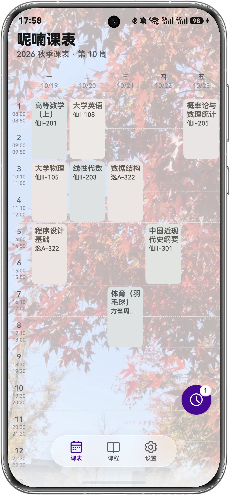
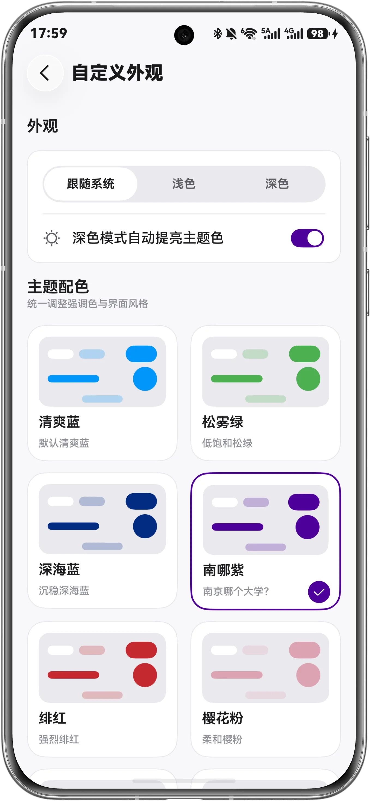
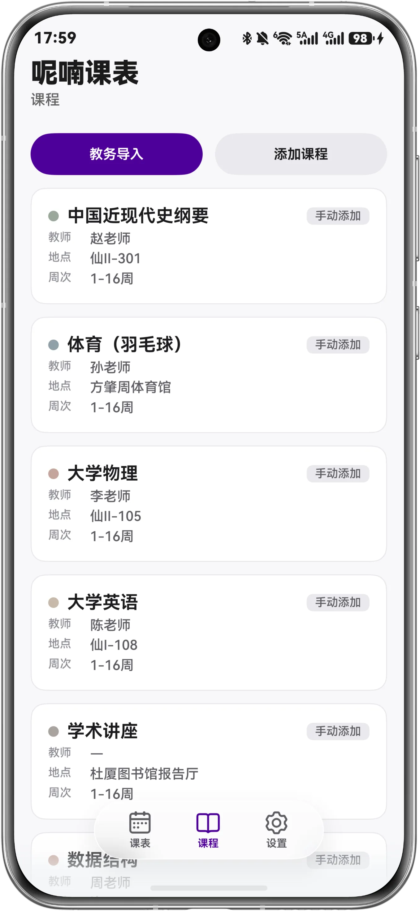
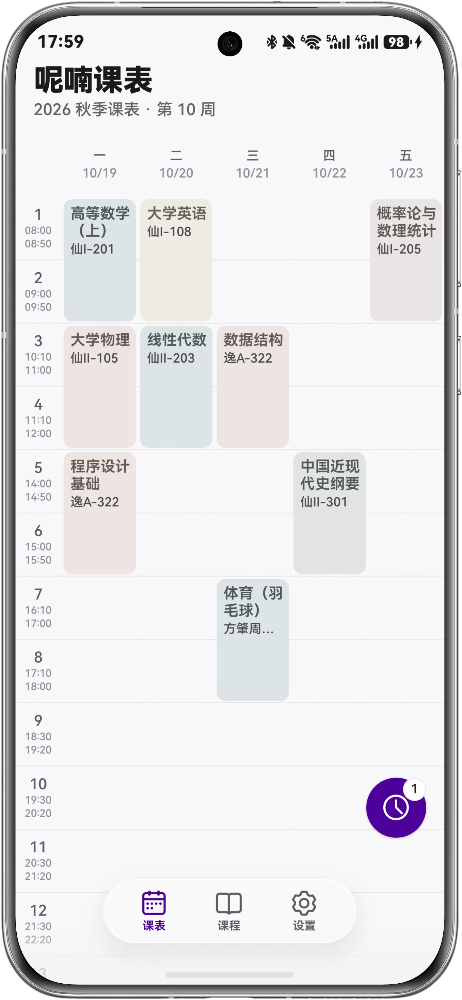
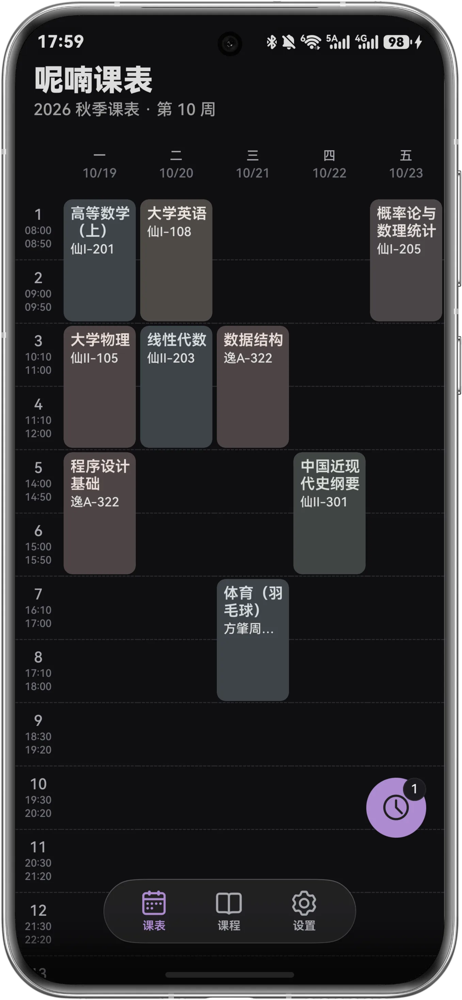
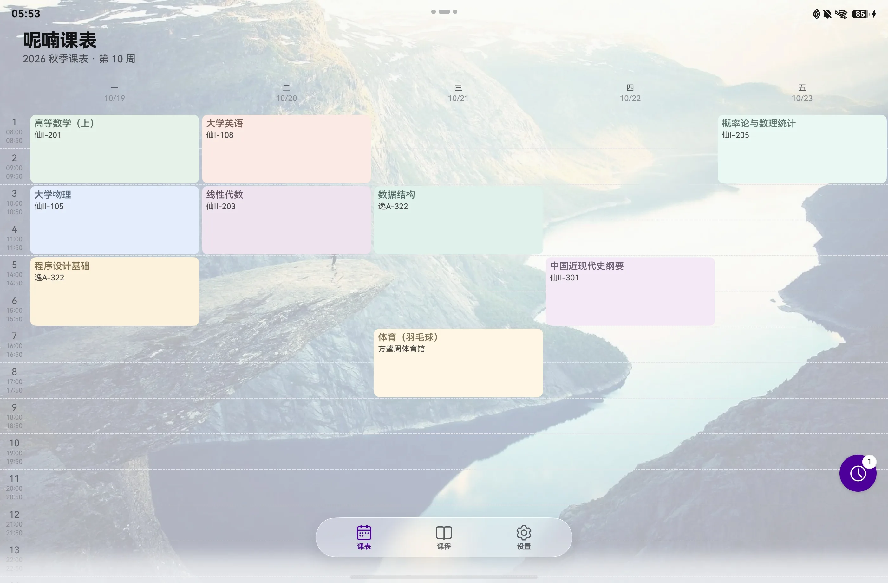
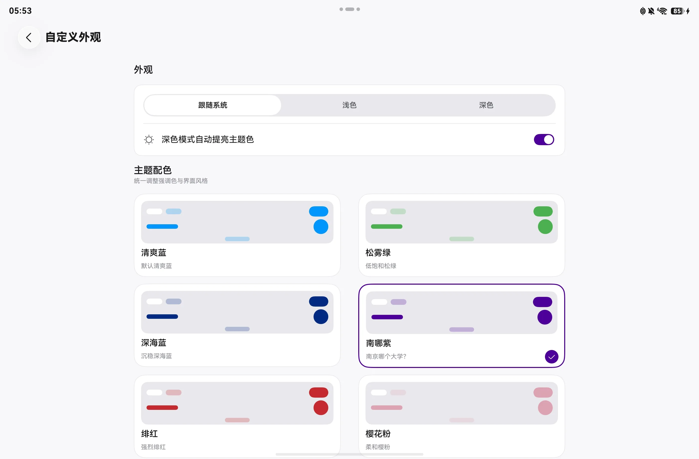
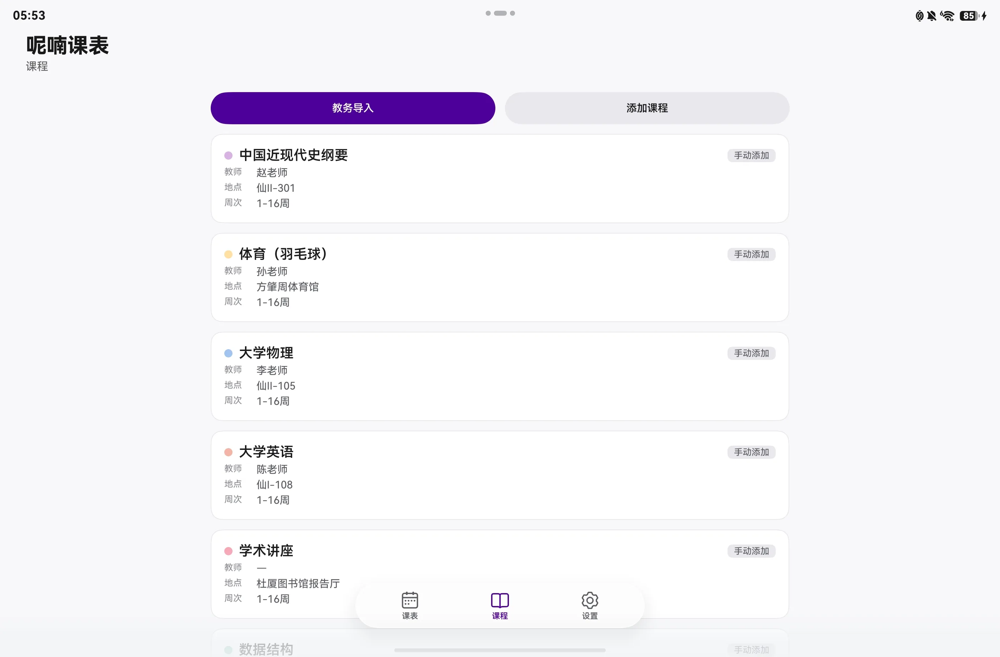
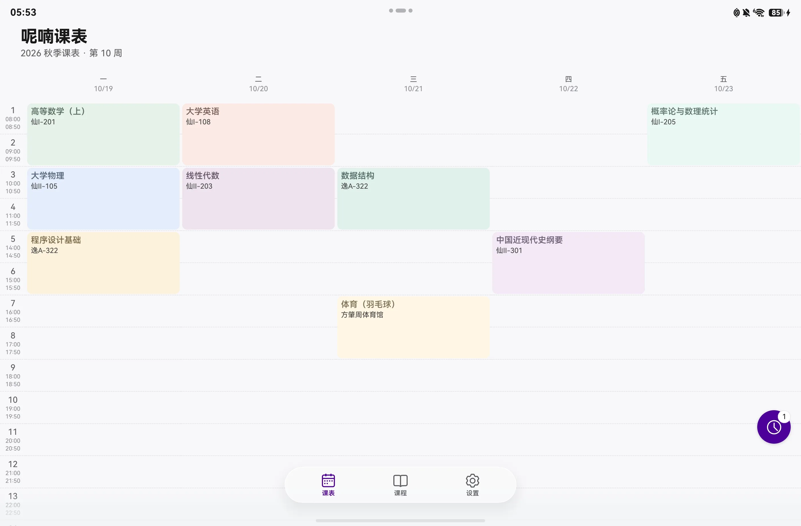
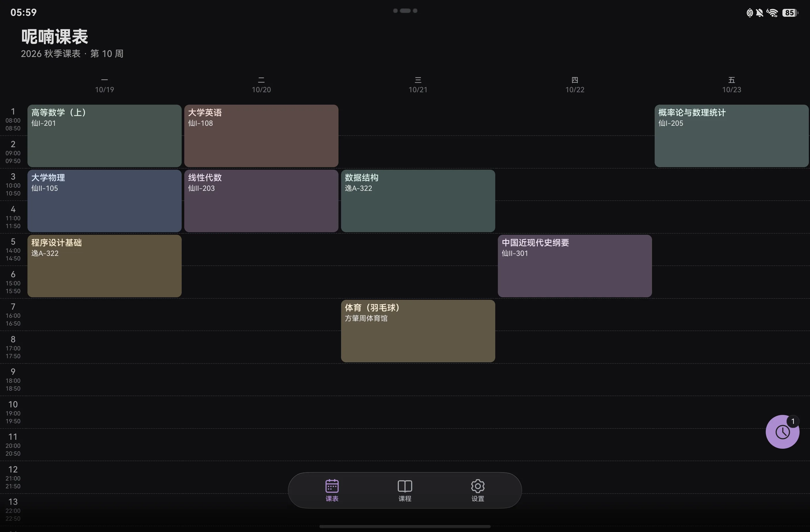

<div align="center">


<h1>呢喃课表（NJU Schedule NEXT）</h1>

**基于南京大学课程表 APP「南哪课表」，并使用 ArkUI 声明式 UI 与状态管理 V2 重写实现。**

</div>

> 本应用不是南京大学官方应用，与学校及教务系统无隶属关系。上游 Flutter 项目：[WheretoSleepinNJU/NJU-Class-Shedule-Flutter](https://github.com/WheretoSleepinNJU/NJU-Class-Shedule-Flutter)（Apache-2.0）。
>
> **仓库**：https://github.com/WheretoSleepinNJU/njuschedule-hmos
>
> **问题反馈**：https://github.com/WheretoSleepinNJU/njuschedule-hmos/issues
> **已正式上架华为 AppGallery**：在应用市场搜索「呢喃课表」即可下载。
>
> 正在招募有兴趣设计图标的同学，请联系JesseLee3923@outlook.com

## 界面预览

截图使用展示数据，不包含真实课表信息。

### 手机

<table>
  <tr>
    <td align="center"><br/>课表背景</td>
    <td align="center"><br/>自定义外观</td>
    <td align="center"><br/>课程管理</td>
    <td align="center"><br/>课程详情</td>
    <td align="center"><br/>深色模式</td>
  </tr>
</table>

### 平板 / 2in1

<table>
  <tr>
    <td align="center"><br/>课表背景</td>
    <td align="center"><br/>自定义外观</td>
    <td align="center"><br/>课程管理</td>
  </tr>
  <tr>
    <td align="center"><br/>课程详情</td>
    <td align="center"><br/>深色模式</td>
    <td></td>
  </tr>
</table>

## 功能

- **课表周视图**：25 周页面横滑切换、今日高亮、非本周淡显、时间冲突角标、自由时间课程、背景图
- **课程管理**：按课程名分组、课程详情、新增/编辑/删除、单双周与自定义周、保存前冲突提示
- **教务导入**：沿用上游各校 `schoolList.json` 配置与页面解析脚本（ArkWeb + JS 注入），导入结果保存在本地
- **课表分享**：`ncs://qr/v2` 分享码/二维码、扫码（分享页标题栏入口）/粘贴导入、多帧自动合并，与旧版 Flutter 版互通
- **讲座**：南大近期讲座列表、标签筛选、一键加入课表
- **桌面小组件**：2x2 / 2x4 今日课程、4x4 本周课表
- **外观**：9 个预设主题色 + 自定义色、深浅色（跟随系统/浅色/深色）、内置与相册背景
- **隐私**：隐私声明使用华为 AGC 托管；无账号、无广告、无统计/推送/崩溃上报 SDK；仅申请 `ohos.permission.INTERNET`

### 目标功能

- **适配系统语言**：界面文案跟随系统语言切换（当前仅中文，后续接入 HarmonyOS 资源字符串与多语言文案）【搁置】
- **接入系统通知**：在上课前一天晚上定时提醒明日课程数目以及最早课程开始时间，可自行设置提醒时间及功能开启与否
- **接入系统日历课程表导入**：暂时不知道怎么做的，目前只有一个名为「超级课程表」的应用接入了

## 技术栈与结构

- HarmonyOS 26 / API 26，Stage 模型，ArkTS 严格模式
- ArkUI **状态管理 V2**：`@ComponentV2` / `@Local` / `@Param` / `@Event` / `@ObservedV2` / `@Trace`，全局 `AppStore` + `AppStorageV2`
- HDS 系统组件（`HdsNavigation` / `HdsTabs` / `HdsNavDestination`）与 ArkData（`relationalStore` / `preferences`）
- `entry/src/main/ets/` 按 `app / common / data / widget / features / pages` 分层；详细命令与目录约定见 [docs/README.md](docs/README.md)

## 构建

需要 DevEco Command Line Tools（`devecocli`）与 HarmonyOS 26 SDK：

```bash
devecocli build                         # 构建未签名 HAP
devecocli check arkts $(find entry/src/main/ets -name '*.ets' | tr '\n' ' ')
devecocli check lint
```

真机安装需要签名；仓库**不携带签名材料**，签名配置方式与常用命令见 [docs/README.md](docs/README.md)。

## 文档

- 开发速查手册（命令、结构、约定）：[docs/README.md](docs/README.md)
- 隐私政策：[华为 AppGallery 托管隐私声明](https://agreement-drcn.hispace.dbankcloud.cn/index.html?lang=zh&agreementId=2068300045962206912)
- 开源许可与致谢：应用内「关于 → 开源许可证 / 第三方许可证 / 致谢」
- 版本记录：[CHANGELOG.md](CHANGELOG.md)

## 贡献

欢迎提交 Issue 与 Pull Request，请先阅读 [CONTRIBUTING.md](CONTRIBUTING.md)、[AGENTS.md](AGENTS.md) 与上述开发文档。安全漏洞请按 [SECURITY.md](SECURITY.md) 私下报告。

## 许可

本项目以 [Apache License 2.0](LICENSE) 发布。上游 Flutter 项目「南哪课表」版权归 idealclover 所有，数据模型、导入配置与脚本、分享码协议等沿用部分见 [NOTICE](NOTICE)。
